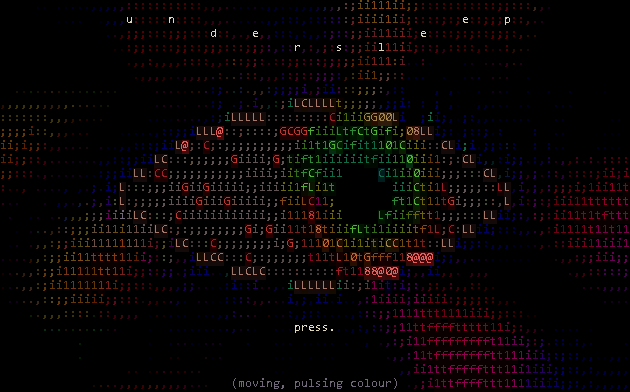

# undersleep



```
npx github:gavingimmestad/undersleep
```

Needs Node 18. A big dark terminal. Alone, if you can.

**Moving, pulsing, high-contrast colour throughout. Please don't play if you are photosensitive.**

It keeps one small file, `~/.undersleep.json`. Delete it if you want to be forgotten.

`q` leaves. MIT.
